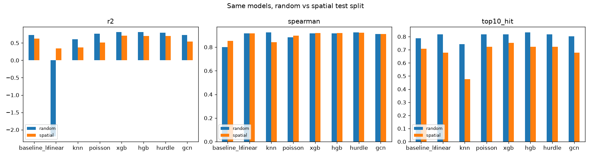
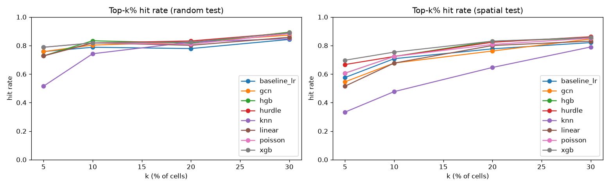
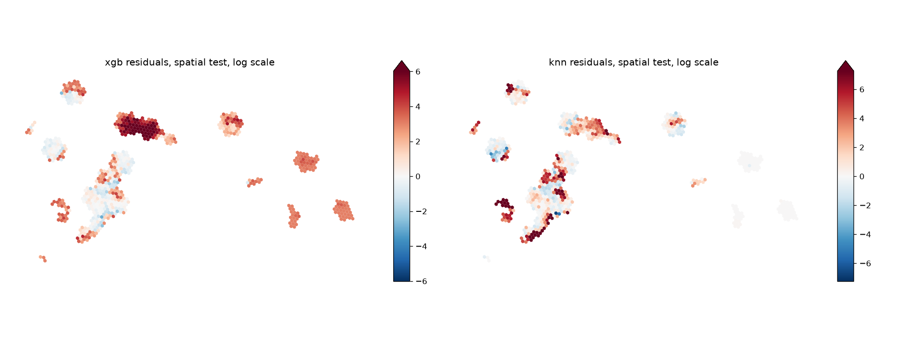
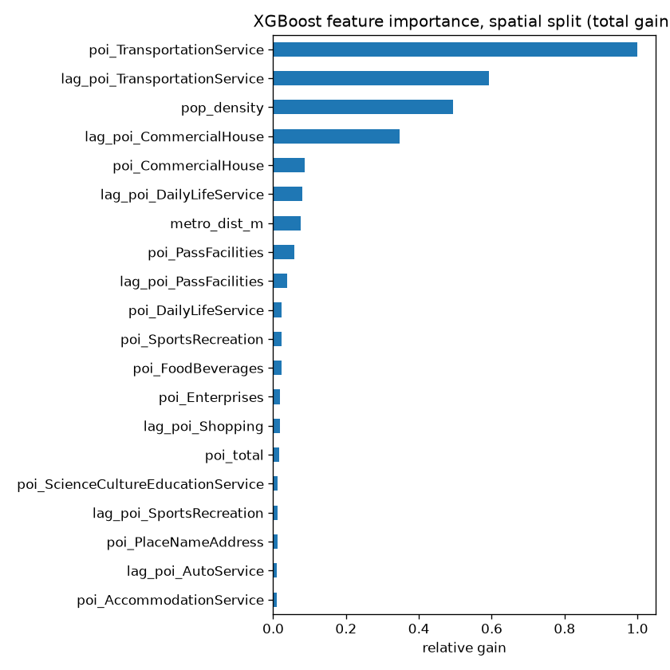

# biketrips

Where will people ride shared bikes in a part of the city a model has never seen? This repo builds a city-wide benchmark for that question in Shenzhen: all 44.6M trips from a month of data, every H3 cell including the third with no trips, a logged audit of every data-quality decision, 52 urban features, and eight models tuned and scored on held-out city blocks. The best model, XGBoost with a Poisson loss, reaches R² 0.71 on unseen blocks. What it misses sits at the extremes: it underpredicts the busiest hubs by about a third, and predicts heavy demand in dense blocks the operator barely serves. Four times more data barely changes the scores.

**Starting point:** the Climate Change AI tutorial *Predicting Mobility Demand from Urban Features* by Konstantin Klemmer, Shafat Rahman, Felix Wagner, Florian Nachtigall, and Gabriela Yaulli Herrera ([repo](https://github.com/climatechange-ai-tutorials/mobility-demand), [DOI](https://doi.org/10.5281/zenodo.11619223)). It introduced the problem, the data and the first models. See [Credit and citation](#credit-and-citation).

## What this repo does

- **Full data, not a sample.** All five trip files (44.6M rows, Jul 31 to Aug 29, 2021) are aggregated with DuckDB, after removing 77k trips that appear twice under different ids. A 100k-trip sample, the size of a 1% sample of one file, leaves 39% of active cells looking empty.
- **Every cell counts.** A full H3 grid over the city boundary (3,272 cells), with zero-trip cells kept. Weekly counts show which zeros persist, which separates service gaps from quiet weeks.
- **Audited data.** Every drop and fill is logged with a row count and a reason (`results/data_quality.md`). The audit found a ~550 m datum mismatch between trips and POIs (GCJ-02 vs WGS84), duplicated trips across overlapping files, and a population file that holds metro stations.
- **Richer features.** All 23 POI categories, spatial lags, population density with a missingness flag, metro distance and bus stops.
- **Honest evaluation.** Whole city blocks are held out, with grouped inner CV for tuning, and a random split is run next to it to measure the spatial leak.
- **Eight models, tuned the same way:** two linear baselines, spatial kNN, Poisson GLM, XGBoost, HistGradientBoosting, a two-part hurdle model and a GCN.
- **Count-aware metrics:** Poisson deviance, Spearman and top-10% hit rate alongside MAE, RMSE and R², with and without trivially empty cells.

## Results

Held-out test scores on the 30-day target. Spatial = 19 unseen res-6 blocks (649 cells); random = 654 random cells. Higher is better except MAE (trips per cell over 30 days).

| Model | R² random | R² spatial | Spearman random | Spearman spatial | Top-10% hit random | Top-10% hit spatial | MAE spatial |
|---|---|---|---|---|---|---|---|
| *Baseline LR (3 POI types, non-zero cells)* | 0.73 | 0.63 | 0.80 | 0.85 | 0.79 | 0.71 | 11,046 |
| Ridge on log1p (variant) | -2.19 | 0.34 | 0.92 | **0.92** | 0.82 | 0.68 | 12,983 |
| Spatial kNN (no features) | 0.60 | 0.37 | **0.93** | 0.84 | 0.74 | 0.48 | 15,394 |
| Poisson GLM | 0.77 | 0.51 | 0.88 | 0.90 | 0.82 | 0.72 | 11,767 |
| **XGBoost (Poisson)** | 0.81 | **0.71** | 0.92 | **0.92** | 0.82 | **0.75** | **9,168** |
| HistGradientBoosting (Poisson) | **0.82** | 0.70 | 0.92 | **0.92** | **0.83** | 0.72 | 9,452 |
| Hurdle: P(any trips) x trips if any | 0.80 | 0.70 | **0.93** | **0.92** | 0.82 | 0.72 | 9,342 |
| GCN (transductive) | 0.73 | 0.54 | 0.91 | 0.91 | 0.80 | 0.68 | 11,780 |

Baseline LR is plain least squares on raw counts of Sports & Recreation, Transportation and Medical POIs, trained only on cells with trips and not tuned. It is the simplest reasonable model and the one this project started from. It is scored on the same test cells as every other model.

- **Only boosted trees clearly beat Baseline LR on unseen blocks.** XGBoost improves R² by 0.09, Spearman by 0.07 and top-10% hit rate by 0.05, and cuts MAE by 17% and Poisson deviance by 45%.
- **The win comes from boosting, not from XGBoost.** sklearn's HistGradientBoosting and the hurdle model, with the same Poisson loss and tuning budget, land within 0.01 R² of XGBoost on unseen blocks.
- **A two-part hurdle model barely helps.** It predicts "any trips?" and "how many?" with the same trees. It predicts empty cells better (median 3 trips vs 11 for the one-part version) but changes MAE and deviance by about 1%.
- **More features and fancier models are not enough on their own.** The Poisson GLM and the GCN use all 52 features but have lower spatial R² than the 3-feature Baseline LR. Ridge on log1p, an early design choice here, ranks cells well but is unstable after the back-transform. Duan's smearing correction made it worse: log errors are far larger on some cells than others, so one constant factor inflates the biggest predictions.
- **Baseline LR has its own flaw: negative counts.** It predicts below zero for 307 of 649 spatial test cells (clipped to 0 before scoring).
- **A random split flatters every model that scores positive R².** Moving to unseen blocks costs 0.10 (XGBoost and Baseline LR) to 0.26 (Poisson GLM) of R², and 0.06 to 0.27 of top-10% hit rate.
- **The features-free kNN shows the leak most clearly.** On the random split it ranks cells as well as the best model (Spearman 0.93); on unseen blocks it is the worst (0.84).
- **More data barely moves the scores.** Against the same experiments on one file (8 days, archived in `results/metrics_file21.csv`), spatial R² rises by 0.004 to 0.018 for every model except ridge, and Spearman by about 0.02. Week to week the pattern is already stable (rank correlation 0.96 to 0.97).
- **The errors sit at the two extremes.** The busiest 10% of test cells hold 63% of test trips and about half of XGBoost's absolute error; it predicts 0.68 of their demand (Baseline LR 0.62, GCN 0.48). At the other end, two dense Longhua blocks near 22.74N, 114.05E (about 340 POIs per cell) get about 2,300 trips in 30 days, steadily every week, while the tree models predict 580k to 600k. Urban features cannot see either: hubs likely reflect transfer points or rebalancing, and gaps reflect where bikes are not placed.
- **A weekly service mask does not fix it.** Scoring only cells with trips in every week lowers XGBoost's spatial R² (0.71 to 0.66). Cells that miss a week hold about 3% of each feature model's absolute error, and the Longhua gap cells still get a trip or two most weeks.
- **Easy zeros do not inflate the headline.** Without trivial cells (no POIs, no known population), R² moves by at most 0.03. See `notebooks/02_results.ipynb`.

Full table (MAE, RMSE, Poisson deviance, clipping counts, inner-CV scores, error by weeks served): `notebooks/02_results.ipynb` and `results/metrics.csv`. Tuning everything takes about 10 minutes on one machine (GCN on GPU).






## What we found in the data

- **Small samples are badly noisy.** A 100k-trip sample leaves 846 of 2,182 active cells looking empty, with a median per-cell error of 43% after scaling. Even one full file (10M trips) misses 231 active cells.
- **Zeros are structural.** 40% to 42% of cells have no trips in any given week and 33% have none in 30 days. 87% to 92% of cells empty in week 1 stay empty in each later week. 1,111 cells never get a trip; 579 of them have POIs, and 75% lie east of 114.25E. Dropping zero cells is tempting, but it removes the hardest part of the problem.
- **Demand is extremely concentrated.** The busiest 10% of cells hold 75% of trips.
- **The files overlap.** Each trip file runs a few days into the next, and 77k trips appear twice under different ids. Ids alone do not catch them; matching on user, start time and start point does.
- **Two coordinate systems are mixed.** Trips and transit stops use GCJ-02 (AMap's offset coordinates); POIs, the boundary and the population raster use WGS84. Uncorrected, trip ends sit about 550 m (more than one cell edge) away from the POIs they are compared with.
- **Demand is spatially smooth** (Moran's I 0.88 on log counts), so a random split puts near-copies of each test cell into training.
- **The population file is not what its name suggests.** `pop/pop.shp` holds 234 metro stations; the population layer is the raster, and 30% of cells fall outside it.
- Every drop and fill, with counts and reasons, is in [`results/data_quality.md`](results/data_quality.md). The full EDA is in `notebooks/01_eda.ipynb`.

## How it works

- **Target:** trip-end count per H3 res-8 cell (about 0.74 km²) over the 30-day window, on the full grid over the Shenzhen boundary: 3,272 cells, 33% of them zero. Counts for each of the 4 full weeks are kept to test whether zeros persist.
- **Features (52):** POI count per big category (23) and their total, the same counts summed over the 6 neighbouring cells, population density with a `pop_missing` flag, distance to the nearest metro station, and bus stop count. Population outside the raster's coverage stays NaN and is imputed inside each model, fit on training rows only.
- **Spatial split:** cells are grouped by their H3 res-6 parent (up to 49 cells, about 36 km²). 20% of groups are the test set, touched once. Hyperparameters are tuned with `GroupKFold(5)` on the remaining groups and ranked by Poisson deviance. The random split uses the same pipeline with plain `KFold`.
- **Models:** Baseline LR (untuned); ridge regression on `log1p(trips)`; spatial kNN (mean of the k nearest training cells, no features); Poisson GLM; XGBoost with `count:poisson` and 40 Optuna trials; sklearn's HistGradientBoosting with a Poisson loss and the same budget; a hurdle model (HistGradientBoosting classifier for P(trips > 0) times a Poisson regressor fit on cells with trips, shared hyperparameters); and a two-layer GCN.
- **The GCN is transductive.** Every cell is a node in one kNN graph. Test cells stay in the graph with their features visible and their labels masked, and early stopping uses held-out training blocks. This is a softer test than for the other models, which never see test cells at all. An inductive model (GraphSAGE) is listed under Next steps.
- **Metrics** are in `src/biketrips/evaluate.py`. Negative predictions are clipped to 0 before scoring (only the two linear models produce them; `n_clipped` in `metrics.csv` counts them). Every run appends to `results/metrics.csv`.

## Reproduce

```bash
uv venv --python 3.12 && source .venv/bin/activate
uv pip install -e ".[dev]"
python scripts/download_data.py           # about 2 GB from the public Google Drive folder
python scripts/build_features.py          # cleaning + features, about 30 s
python scripts/run_experiments.py --model all
jupyter nbconvert --to notebook --execute --inplace notebooks/01_eda.ipynb notebooks/02_results.ipynb
pytest
```

All paths, seeds (42) and search spaces are in `configs/config.yaml`. The GCN uses a GPU when one is available. DuckDB loads its `h3` community extension on first use, which needs internet access once.

## Repo layout

```
configs/config.yaml        paths, H3 settings, CV, search spaces
scripts/                   download, build features, run experiments
src/biketrips/             data, quality, features, splits, models/, tune, evaluate, plots
notebooks/                 00 starting-point tutorial (unchanged), 01 EDA, 02 results
results/                   metrics.csv, best_params.yaml, data_quality.md, predictions, figures/
tests/                     cleaning rules, grid and features, splits and metrics
```

## Limitations

- **Zero does not always mean no demand.** A cell with no trip ends may have had no bikes. The east of the city (east of 114.25E) holds 35% of cells but 0.9% of trips, and its zeros persist week after week, which looks like the operator's service area rather than low demand. Models are scored on these cells as true zeros.
- **One operator, one month, summer only.** Trips run from 2021-07-31 to 2021-08-29; the first and last days are partial.
- **Counts are overdispersed** (variance about 89,000 times the mean). The Poisson models rank and scale cells well, but their implied uncertainty is far too narrow.
- **The GCJ-02 shift is a constant offset** estimated from POIs that carry both coordinate systems. Its spread is about 13 m, small next to a 460 m cell edge.

## Next steps

- A zero-truncated count part for the hurdle model, or a negative binomial GLM for the overdispersion.
- GraphSAGE or another inductive GNN that can score areas outside the training graph.
- A cell-by-hour model on the full dataset (start and end times are already kept in `data/interim/`).
- Origin-destination flows instead of trip ends alone.
- Separating supply from demand with bike availability or rebalancing data; trip counts alone cannot tell them apart.
- Hub cells: transfer-point or event features to explain the busiest cells, which every model underpredicts.
- A "where to add bikes" map: cells with high predicted demand but few observed trips, as candidates for new bikes or stations.
- Transfer to another city.

## Credit and citation

This project started from *Predicting Mobility Demand from Urban Features*, Climate Change AI Summer School 2023, by Konstantin Klemmer, Shafat Rahman, Felix Wagner, Florian Nachtigall, and Gabriela Yaulli Herrera ([repo](https://github.com/climatechange-ai-tutorials/mobility-demand), [DOI](https://doi.org/10.5281/zenodo.11619223)).

- **From the tutorial:** the problem framing (trip ends per H3 cell from POI counts), the Shenzhen trip, POI, boundary, population and transit data, the H3 resolution-8 grid, the linear regression used as Baseline LR, the two-layer GCN architecture, and the suggestion to try gradient boosting.
- **Everything else** listed under [What this repo does](#what-this-repo-does) was added here.
- **Data:** Shenzhen bike-share trip data and AMap POI data, as distributed with the tutorial.
- The tutorial notebook is kept unchanged at `notebooks/00_original_tutorial.ipynb` (MIT license, see `LICENSE`).

```bibtex
@misc{klemmer2026predicting,
  title={Predicting Mobility Demand from Urban Features},
  author={Klemmer, Konstantin and Rahman, Shafat and Wagner, Felix and Nachtigall, Florian and Herrera, Gabriela Yaulli},
  year={2026},
  organization={Climate Change AI},
  type={Tutorial},
  doi={https://doi.org/10.5281/zenodo.11619223},
  booktitle={Climate Change AI Summer School},
  howpublished={\url{https://github.com/climatechange-ai-tutorials/mobility-demand}}
}
```
